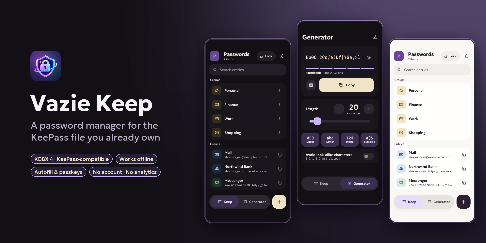
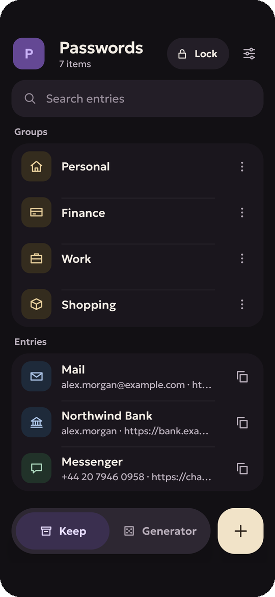
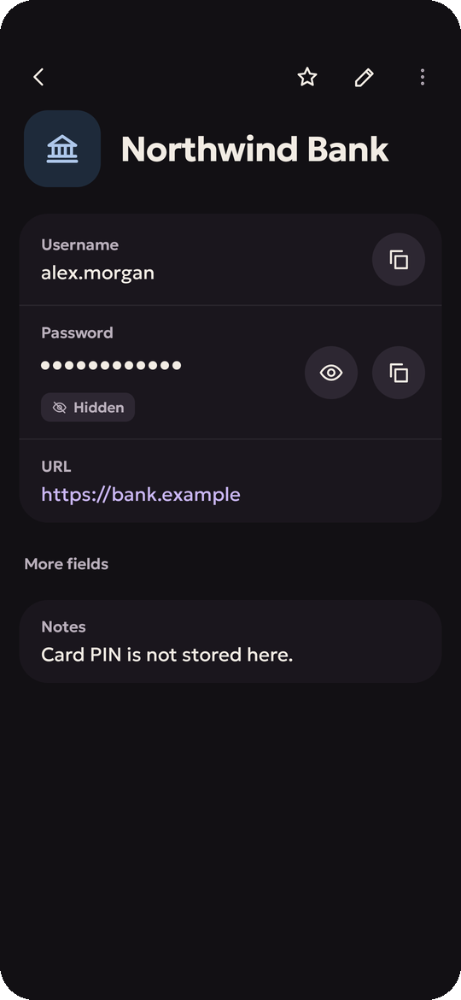
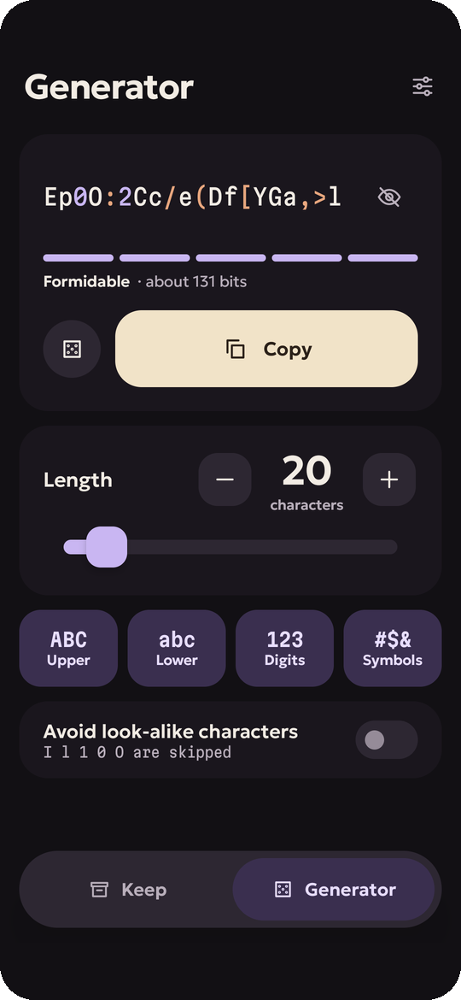
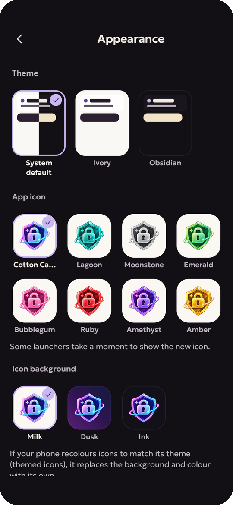

**English** | [Русский](README.ru.md)

<p align="center">
  
</p>

<h1 align="center">Vazie Keep</h1>

<p align="center">
  A password manager for the KeePass file <b>you already own</b>.<br>
  No account, no cloud, no lock-in — the database stays where you put it.
</p>

<p align="center">
  <a href="https://vazie.app/keep">vazie.app/keep</a> ·
  <a href="CHANGELOG.md">Changelog</a> ·
  <a href="docs/security/SECURITY_MODEL.md">Security model</a> ·
  <a href="ARCHITECTURE.md">Architecture</a> ·
  <a href="https://t.me/vazieapp">Telegram</a>
</p>

<p align="center">
  
</p>

## What it does

Vazie Keep opens a KeePass database (KDBX 4) from wherever you keep it — the phone, a cloud folder, a USB stick — and
writes changes back to the same file. KeePassXC and other KeePass apps keep working with it.

| Feature | What it means |
|---|---|
| 🗂️ **Your file, your place** | Open or create a `.kdbx`; changes go back to the same file. Nothing is uploaded anywhere. |
| ✈️ **Works offline** | Opening, editing, creating and saving a database never needs a connection. |
| 🙈 **Secrets stay hidden** | Copy, reveal and edit are explicit; the clipboard clears itself and the app locks on its own. |
| 💾 **Safe save** | A backup and a write-ahead copy before the file is touched, and what was written is read back. |
| 🔀 **Merge** | If the file was changed on another device, your changes and theirs are combined. A clash on one entry keeps both versions. |
| 🔑 **Unlock your way** | Master password, key files, fingerprint or face. |
| ✍️ **Autofill and passkeys** | Fill logins in apps and sites, save new ones from the form you just filled, sign in with passkeys. |
| 🎲 **Generator** | Passwords and passphrases with every option. |
| 📥 **Import** | From browsers, KeePassXC, LastPass, 1Password and Bitwarden. |

All of that is free and stays free — no ads, no nagging, nothing locked. **Keep+** adds extras: several databases,
one-time codes, the entry history and adding attachments. See
[what is free and what is Keep+](docs/product/KEEP_PLUS.md).

## Screenshots

<p align="center">
  
  
  
  
</p>

<sub>Every screen is the real app with an invented demo database
([`tooling/screenshots`](tooling/screenshots)).</sub>

## Privacy

- The database never leaves your device through Vazie: no Vazie cloud, no sync service, no copy on our servers.
- No ads, no analytics or crash-reporting SDKs.
- The **Vazie Account** is optional and exists only for Keep+. It holds an e-mail address and the Keep+ entitlement —
  never a database, an entry, a URL or a count of databases.
- The app goes online only for the optional account and Keep+, the update check and the help texts — and to a website
  only when you ask for its icon or a passkey check needs it.

## Download

Android 8.0 or newer. Download `VazieKeep-<version>.apk` from the
[latest release](https://github.com/vazie-app/VazieKeep/releases/latest): each release carries the APK, its SHA-256
checksum, the signing certificate and the notes.

Every official APK is signed with the Vazie release key:

```
CN=Vazie, OU=Application Signing, O=Vazovsky Development
SHA-256 fe4fff544cac1a77813dbaba304d35a2100999f9c4fe3b8bc0ab0ae21d867eb6
```

Check a download with `apksigner verify --print-certs VazieKeep-<version>.apk`.

## Platforms

| | State |
|---|---|
| Android 8+ | 1.0.0 — [Releases](https://github.com/vazie-app/VazieKeep/releases) |
| iPhone | In development, builds from this repository |
| Windows, Linux, macOS | Early skeleton |
| Browser extension | Chrome, Edge, Brave and other Chromium browsers: the full app, built from this repository ([`apps/browser-extension`](apps/browser-extension)) |

## How it is built

There is exactly one implementation of vault logic: a Rust core. KDBX parsing, cryptography, the entry tree, search
and the generator live in [`core/`](core); the apps render UI and plug platform services into it.

```
keep-core (Rust) ─┬─ keep-core-ffi (UniFFI) ─┬─ Kotlin ─ Android, desktop
                  │                          └─ Swift ── iPhone, macOS
                  └─ keep-core-wasm ─────────── TypeScript ─ browser extension
```

The decrypted database never leaves Rust in bulk. An app holds an opaque handle and asks for one secret at a time, as
bytes it wipes after use. Design decisions are recorded as [ADRs](docs/adr); the threat models are in
[docs/security](docs/security).

## Building

```bash
scripts/bootstrap.sh                                         # Rust toolchain, targets, wasm-bindgen, cargo-ndk
(cd apps/android && gradle wrapper --gradle-version 9.8.0)   # gradle-wrapper.jar is not in git
scripts/check.sh all                                         # or: core | android | apple | desktop | extension
cd apps/android && ./gradlew :app:installDebug
```

More in [docs/development](docs/development). A release build is signed only with `signKeystore/keystore.properties`,
which is not in git, and it needs the backend addresses (`VAZIE_ACCOUNT_ORIGIN`, `VAZIE_KEEP_ORIGIN`,
`VAZIE_SITE_ORIGIN`) from `apps/android/local.properties` or the environment; the
[release workflow](.github/workflows/release.yml) takes the key and the addresses from the secrets of its `release`
environment, then builds and checks a tagged version. Building for your own use is allowed; what you may distribute is
in the [licence](LICENSE) and in [TRADEMARKS.md](TRADEMARKS.md).

## Security

Report vulnerabilities privately — see [SECURITY.md](SECURITY.md). Never send a real database or real credentials;
build a throwaway one that shows the problem.

## Licence and brand

Vazie Keep is **source-available** under the [PolyForm Shield License 1.0.0](LICENSE): you can read, build, change and use
it, for yourself or in your company, but not to provide a product that competes with Vazie Keep. It is not an open-source
licence in the OSI sense. Third-party components keep their own licences:
[THIRD_PARTY_NOTICES.md](THIRD_PARTY_NOTICES.md). The names and icons are not part of the licence:
[TRADEMARKS.md](TRADEMARKS.md). Contributions are welcome — read [CONTRIBUTING.md](CONTRIBUTING.md) first.

Designed and built by **Vazovsky** ([@vazovsky17](https://t.me/vazovsky17)) · support: support@vazie.app · news:
Telegram [@vazieapp](https://t.me/vazieapp)
