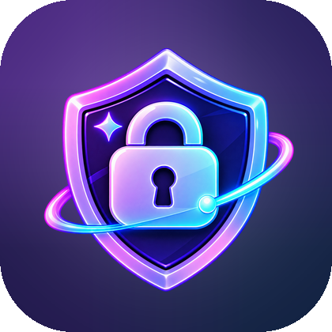
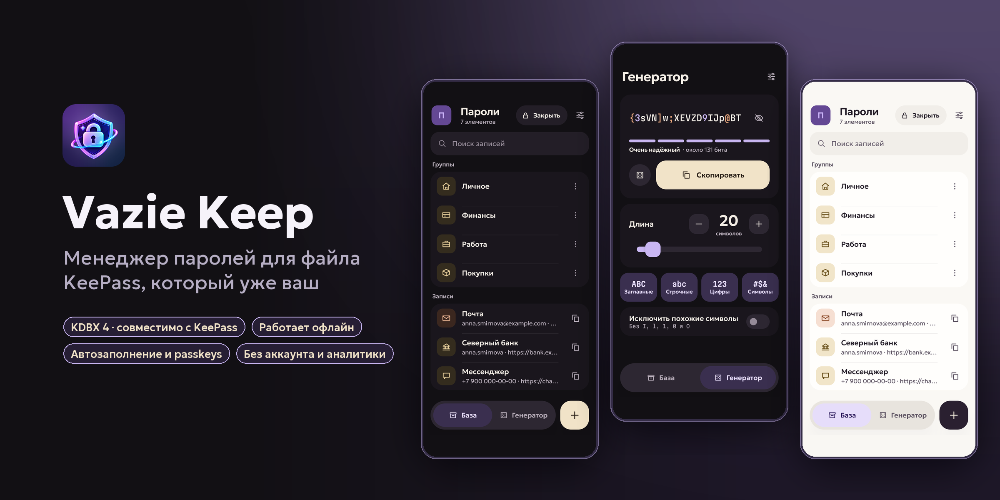
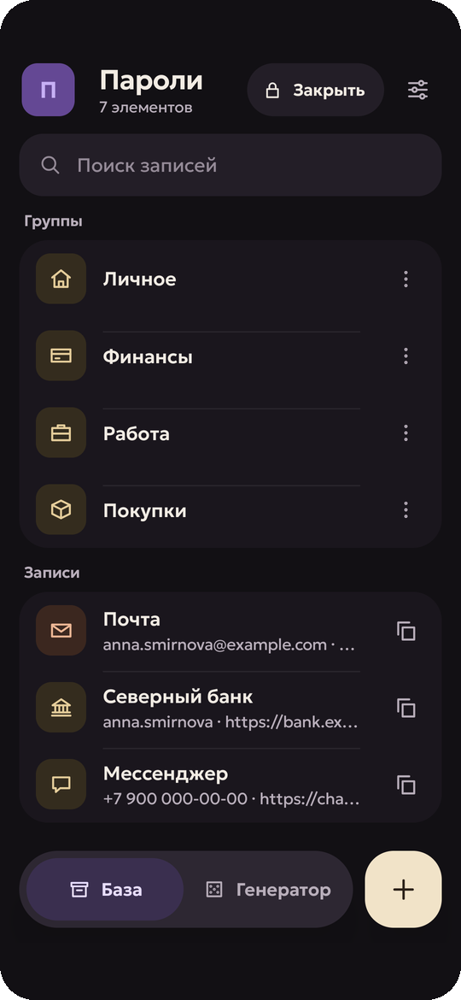
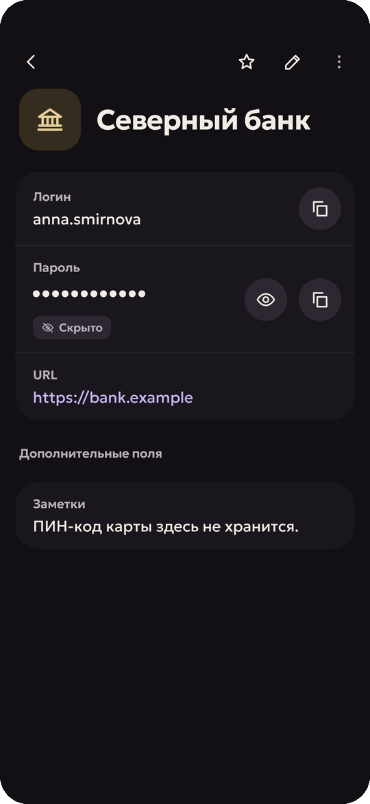
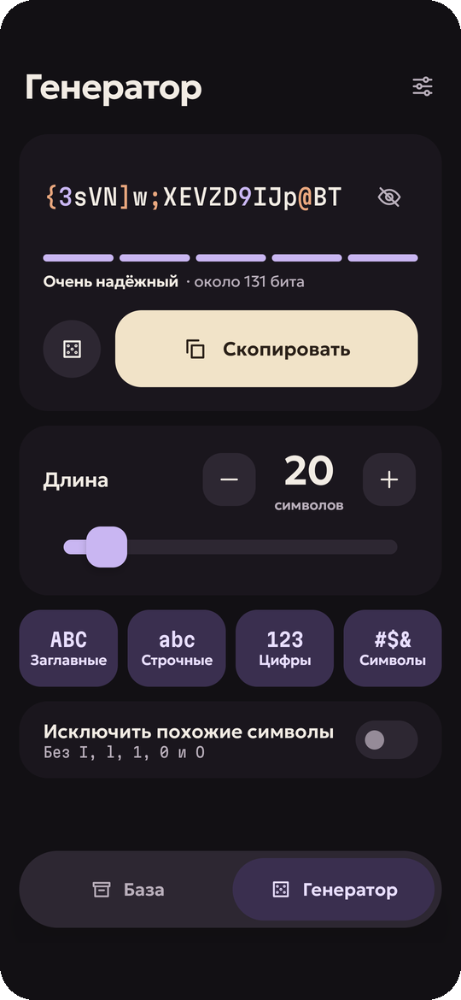
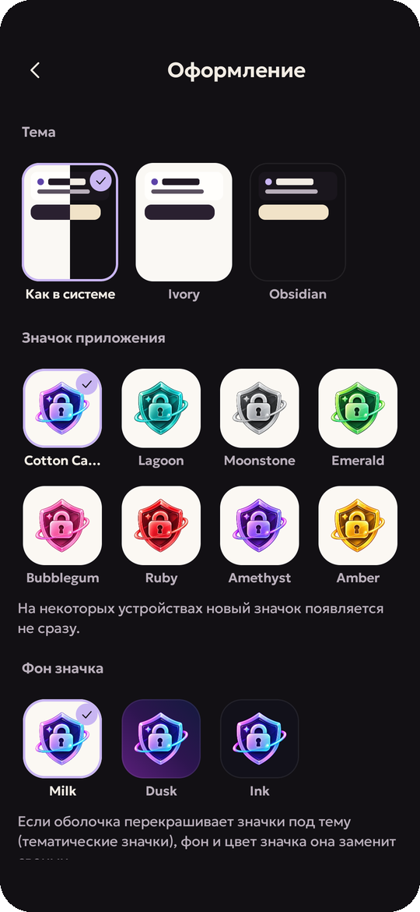

[English](README.md) | **Русский**

<p align="center">
  
</p>

<h1 align="center">Vazie Keep</h1>

<p align="center">
  Менеджер паролей для файла KeePass, который <b>уже ваш</b>.<br>
  Без аккаунта, без облака, без привязки — база лежит там, куда вы её положили.
</p>

<p align="center">
  <a href="https://vazie.app/keep">vazie.app/keep</a> ·
  <a href="CHANGELOG.md">Изменения</a> ·
  <a href="docs/security/SECURITY_MODEL.md">Модель безопасности</a> ·
  <a href="ARCHITECTURE.md">Архитектура</a> ·
  <a href="https://t.me/vazieapp">Telegram</a>
</p>

<p align="center">
  
</p>

## Что это

Vazie Keep открывает базу KeePass (KDBX 4) оттуда, где вы её храните, — с телефона, из облачной папки, с флешки — и
записывает изменения в тот же файл. KeePassXC и другие приложения KeePass продолжают с ней работать.

| Возможность | Что это значит |
|---|---|
| 🗂️ **Ваш файл там, где вы его храните** | Откройте или создайте `.kdbx` — изменения пишутся в тот же файл. Ничего никуда не загружается. |
| ✈️ **Работает офлайн** | Чтобы открыть, изменить, создать или сохранить базу, интернет не нужен. |
| 🙈 **Секреты скрыты** | Копирование, показ и правка — отдельные действия; буфер обмена очищается сам, приложение само блокируется. |
| 💾 **Безопасное сохранение** | Перед записью — резервная копия и журнал, а записанное перечитывается. |
| 🔀 **Объединение** | Если файл изменили на другом устройстве, ваши правки и чужие объединяются. При конфликте одной записи остаются обе версии. |
| 🔑 **Вход как удобно** | Мастер-пароль, ключ-файл, отпечаток пальца или лицо. |
| ✍️ **Автозаполнение и passkeys** | Подставляет логины в приложения и сайты, сохраняет новые прямо из формы, входит по passkeys. |
| 🎲 **Генератор** | Пароли и парольные фразы со всеми настройками. |
| 📥 **Импорт** | Из браузеров, KeePassXC, LastPass, 1Password и Bitwarden. |

Всё это бесплатно и останется бесплатным — без рекламы, напоминаний и заблокированных баз. **Keep+** добавляет
удобства: несколько баз, одноразовые коды, историю изменений записей и добавление вложений. Подробнее —
[что бесплатно, а что в Keep+](docs/product/KEEP_PLUS.md).

## Скриншоты

<p align="center">
  
  
  
  
</p>

<sub>Каждый экран — настоящее приложение с вымышленной демо-базой
([`tooling/screenshots`](tooling/screenshots)).</sub>

## Приватность

- База не уходит с устройства через Vazie: нет облака Vazie, сервиса синхронизации и копии на наших серверах.
- Без рекламы, аналитики и SDK отчётов о сбоях.
- **Vazie Account** не обязателен и нужен только для Keep+. В нём адрес почты и право на Keep+ — никогда база,
  запись, адрес сайта или число баз.
- В сеть приложение выходит только для необязательного аккаунта и Keep+, проверки обновлений и справочных текстов —
  и на сайт, только когда вы просите его значок или этого требует проверка passkey.

## Скачать

Android 8.0 и новее. Скачайте `VazieKeep-<версия>.apk` из
[последнего выпуска](https://github.com/vazie-app/VazieKeep/releases/latest): в каждом выпуске — APK, его контрольная
сумма SHA-256, сертификат подписи и описание изменений.

Каждый официальный APK подписан ключом выпусков Vazie:

```
CN=Vazie, OU=Application Signing, O=Vazovsky Development
SHA-256 fe4fff544cac1a77813dbaba304d35a2100999f9c4fe3b8bc0ab0ae21d867eb6
```

Проверить скачанный файл: `apksigner verify --print-certs VazieKeep-<версия>.apk`.

## Платформы

| | Состояние |
|---|---|
| Android 8+ | 1.0.0 — [Releases](https://github.com/vazie-app/VazieKeep/releases) |
| iPhone | В разработке, собирается из этого репозитория |
| Windows, Linux, macOS | Ранний каркас |
| Расширение для браузера | Chrome, Edge, Brave и другие браузеры на Chromium: всё приложение целиком, собирается из этого репозитория ([`apps/browser-extension`](apps/browser-extension)) |

## Как устроено

Логика базы реализована ровно один раз — в ядре на Rust. Разбор KDBX, криптография, дерево записей, поиск и
генератор живут в [`core/`](core); приложения рисуют интерфейс и подключают к ядру сервисы платформы.

```
keep-core (Rust) ─┬─ keep-core-ffi (UniFFI) ─┬─ Kotlin ─ Android, desktop
                  │                          └─ Swift ── iPhone, macOS
                  └─ keep-core-wasm ─────────── TypeScript ─ расширение для браузера
```

Расшифрованная база не покидает Rust целиком. Приложение держит непрозрачный дескриптор и просит по одному секрету,
байтами, которые стирает после использования. Решения записаны в [ADR](docs/adr), модели угроз — в
[docs/security](docs/security).

## Сборка

```bash
scripts/bootstrap.sh                                         # Rust-тулчейн, таргеты, wasm-bindgen, cargo-ndk
(cd apps/android && gradle wrapper --gradle-version 9.8.0)   # gradle-wrapper.jar не в git
scripts/check.sh all                                         # или: core | android | apple | desktop | extension
cd apps/android && ./gradlew :app:installDebug
```

Подробнее — в [docs/development](docs/development). Release-сборка подписывается только через
`signKeystore/keystore.properties`, которого нет в git, и требует адреса бэкенда (`VAZIE_ACCOUNT_ORIGIN`,
`VAZIE_KEEP_ORIGIN`, `VAZIE_SITE_ORIGIN`) из `apps/android/local.properties` или из окружения;
[release-workflow](.github/workflows/release.yml) берёт ключ и адреса из секретов своего окружения `release`, собирает и
проверяет версию по тегу. Собирать для себя можно; что можно распространять — в [лицензии](LICENSE) и в
[TRADEMARKS.md](TRADEMARKS.md).

## Безопасность

Об уязвимостях сообщайте приватно — см. [SECURITY.md](SECURITY.md). Никогда не присылайте настоящую базу или
настоящие пароли: соберите тестовую, на которой видна проблема.

## Лицензия и бренд

Исходный код Vazie Keep **доступен** по [лицензии PolyForm Shield 1.0.0](LICENSE): его можно читать, собирать, менять и
использовать — для себя или в своей компании, — но нельзя делать на нём продукт, конкурирующий с Vazie Keep. Это не
открытая лицензия в смысле OSI. Сторонние компоненты — под своими лицензиями:
[THIRD_PARTY_NOTICES.md](THIRD_PARTY_NOTICES.md). Названия и значки в лицензию не входят:
[TRADEMARKS.md](TRADEMARKS.md). Помощь приветствуется — сначала прочитайте [CONTRIBUTING.md](CONTRIBUTING.md).

Автор — **Vazovsky** ([@vazovsky17](https://t.me/vazovsky17)) · поддержка: support@vazie.app · новости:
Telegram [@vazieapp](https://t.me/vazieapp)
